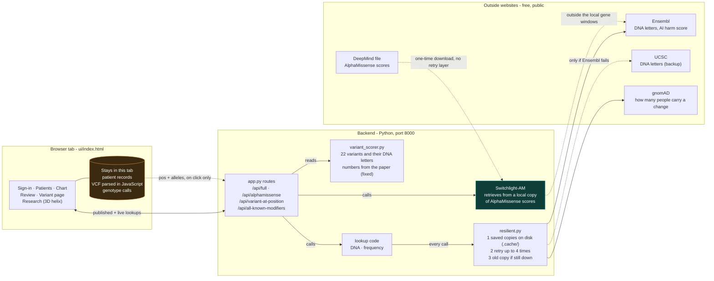

# Switchlight

Sickle cell modifier explorer: the published fetal-hemoglobin variants, the DNA "switches" (enhancers) that dim or brighten them, and a counselor view for reviewing a genotype file.

## Architecture



**What leaves the browser.** Opening a published variant sends only its rs number. A clicked unknown variant also sends its position and DNA letters (dotted amber line in the picture). The uploaded genotype file never leaves the tab.

**How one lookup survives a flaky website.** Every public call checks the saved copies first, retries with growing waits, then uses an older saved copy; DNA letters fall back to UCSC. Only after that does the page show an error.

**Switchlight-AM.** AlphaMissense scores are read from a local SQLite copy built once from DeepMind's file (`python build_am_index.py`). Positions outside the indexed gene windows fall back to live Ensembl. The explanation text is written only from the rows it retrieved.

## Why this needs to run on YOUR machine, not in a sandbox

This project calls real external biology databases (Ensembl, gnomAD) that
aren't reachable from Claude's sandboxed code environment. Everything here
has been structurally verified (imports cleanly, routes register, logic is
tested against sample data) but the actual live network calls need to
run where you have real internet access.

## Setup

```bash
cd backend
pip install -r ../requirements.txt
```

## Run the backend

```bash
cd backend
uvicorn app:app --reload --port 8000
```

Then open http://localhost:8000/docs in your browser -- FastAPI
auto-generates an interactive API tester, so you can try every endpoint
by hand before wiring up the frontend.

## Test each piece independently first

Before trusting the combined API, run each data script on its own to
confirm real data comes back:

```bash
cd backend
python gnomad_lookup.py      # should print real gnomAD data for rs1427407
python sequence_lookup.py    # should print 151 real bases around chr2:60,490,908
python variant_scorer.py     # no network needed -- pure logic, runs anywhere
```

## What's real vs. what's a TODO

**Fully real and working** (once run with network access):
- Known modifier lookup (22 real variants, real published statistics)
- gnomAD population frequency lookup
- Ensembl real sequence fetch
- AlphaMissense live scoring (coding variants only)
- ACMG PP3/BP4/PM2 classification logic

**Still a TODO** (see comments in `app.py`):
- AlphaMissense scores are fetched live through Ensembl's VEP REST service
  (`backend/alphamissense_lookup.py`). The earlier pysam remote-tabix route could not
  work because DeepMind's file has no published `.tbi` index. Only missense (coding)
  variants get a score; non-coding positions return "no score" by design.
- **Switchlight-AM** (`backend/switchlight_am.py`): AlphaMissense is looked up in a local SQLite copy
  first, then falls back to live Ensembl VEP for positions outside the indexed gene windows. Build the
  copy once with `cd backend && python build_am_index.py` (streams DeepMind's 643 MB file and keeps the
  windows for BCL11A, HBS1L-MYB, HBB/HBG, HMOX1, ANTXR1 and HIF1A; use `--all` for the whole genome,
  several GB). The explanation text is written only from the retrieved rows, and is rule-based today.
  AlphaMissense is (c) 2023 DeepMind, CC BY-NC-SA 4.0: non-commercial use with attribution
  (Cheng et al. 2023, Science).
- All 22 known modifiers now have GRCh38 coordinates in `CONFIRMED_COORDINATES`
  (checked against Ensembl and NCBI dbSNP). Two effect alleles are inferred rather
  than taken from the source paper; see `effect_allele_source` in `variant_scorer.py`.
- Section C of the UI checks a VCF against the 22 variants entirely in the browser.
  `sample_data/patient_sample.vcf` is the sample genotype file. Do not load real
  patient genomes until Information Security and Legal have approved the workflow.
- The frontend (3D helix) still needs its `simulateAIScore()` placeholder
  swapped for a real `fetch()` call to this API -- see Next Steps.

## Next steps

1. Run the three test scripts above, confirm real data comes back
2. Verify a few more known modifiers' real coordinates and add them to
   `CONFIRMED_COORDINATES`
3. Run `python alphamissense_lookup.py` to confirm the column format
4. Update the frontend to call `http://localhost:8000/api/variant-at-position`
   instead of its current placeholder logic
